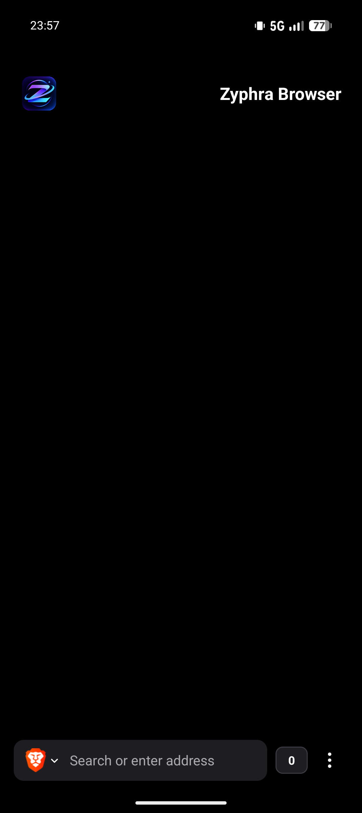
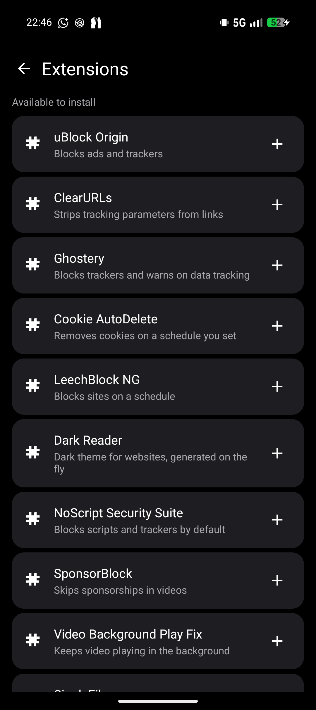
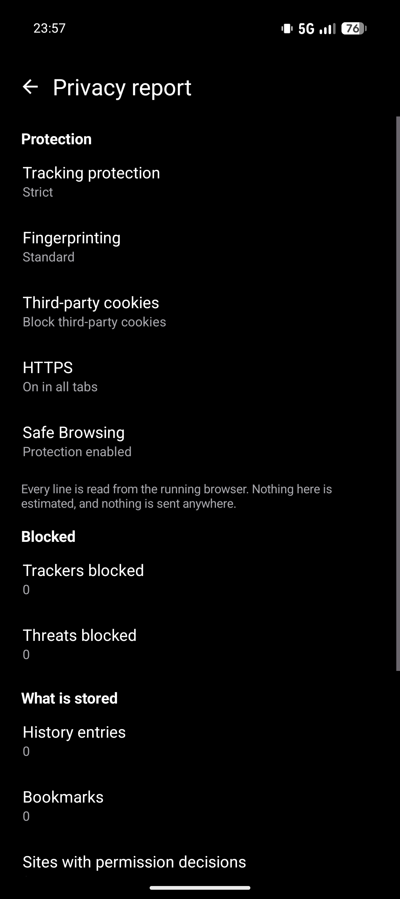

<p align="center">
  
</p>

# Zyphra Browser

**Zyphra Browser** is a private, GeckoView-powered web browser for Android — the
same engine as Firefox Desktop — with a hardened privacy configuration. No
telemetry, no tracking, no accounts.

---

> ## ⚠️ Independent community project
>
> **Zyphra Browser is an independent project** and is **not affiliated with,
> endorsed by, or supported by Mozilla**. No part of this repository is
> reviewed or audited by them.
>
> This project takes no money, sends nothing anywhere, and has no analytics.
> You are running a community build, and you should treat it that way.

---

## Which build should I install?

There is one: **[v1.0](https://github.com/palashsuryavanshi/ZyphraAndroid/releases/tag/v1.0)**,
the first release, signed with the project's release key.

| | |
|---|---|
| Version | `1.0`, `versionCode` **1** |
| Signed with | the project's **release key** — v2 and v3 signature schemes |
| Android | 8.0 (API 26) or newer |

### There is also an F-Droid build

The release above contains Google Play Services, which GeckoView pulls in for
WebAuthn. F-Droid's inclusion policy does not allow them, so
`./gradlew assembleRelease -PfdroidBuild=true` produces a build with Play
Services excluded — verified to contain **zero** `com.google.android.gms`
classes. The cost is that **passkey sign-in does not work in that build**;
everything else, including ordinary logins, is unaffected. The GitHub release
you are looking at keeps Play Services and does support passkeys.

See [`docs/FDROID.md`](docs/FDROID.md).

### Known limitation: extensions are unverified

**No add-on has ever been installed.** The fourteen add-on rows render and every
URL resolves to a real XPI, but nobody has tapped one and watched GeckoView fetch
and register it. That is the largest untested thing in this build. If you install
one, that is the first thing worth trying — please report what happens.

---

## Requirements

| | |
|---|---|
| **Android** | 8.0 Oreo (API 26) or newer |
| **Architecture** | `arm64-v8a` (most phones), `armeabi-v7a` (32-bit ARM), `x86_64` (emulators, x86 tablets) |
| **Download** | ~85 MB for the arm64 release APK |
| **Disk after install** | **~200 MB**, and it grows with what you store |
| **Network** | Required. There is no offline mode and no bundled content. |

On disk the app is much larger than the APK you download: the engine's
`libxul.so` is **143 MB on its own** and is stored uncompressed so GeckoView can
`mmap` it. Budget roughly 200 MB before you start downloading files.

Check your ABI with:

```bash
adb shell getprop ro.product.cpu.abi
```

The app declares no `required` hardware features, so it installs on devices
without a camera, microphone or GPS.

---

## What this is, and what it is not

This project is a native Android browser written in Kotlin, built around the
GeckoView engine — the same rendering engine Firefox uses. Its privacy
configuration is a hardened baseline: strict tracking protection, query
stripping, HTTPS-only mode, encrypted DNS and no telemetry, implemented in
`ZyphraDefaults.kt` and applied at engine construction.

That distinction matters, so to be plain about it:

- **GeckoView** supplies HTML, CSS, JavaScript, WebAssembly, WebGL, cookies,
  service workers, WebRTC, WebAuthn, storage, and DRM.
- **This project** supplies everything Android-shaped: tabs, the address bar,
  prompts, permissions, downloads, history, bookmarks, the password vault,
  settings, media integration, and system integration.

Where the engine does not expose a switch, the mapping is documented in
[How the defaults are implemented](#how-the-defaults-are-implemented).

**Engine:** GeckoView `147.0.20260212191108` — the newest stable whose AAR
targets `compileSdk 37`. Versions 154/155 require SDK 37.1, which has no stable
platform yet.

**No Chromium, no Android WebView rendering.** There is no `WebView` component
in the manifest and no `android.webkit.WebView` is instantiated anywhere. Every
byte of page rendering goes through GeckoView's `libxul.so`.

Two `android.webkit` *utility* classes are used, neither of which renders
anything: `URLUtil.guessFileName` to derive a filename from a
`Content-Disposition` header, and `CookieManager` in one narrow download
fallback — see [Known oddities](#known-oddities).

---

## Screenshots

All three taken on a Pixel 9a, dark theme.

| Start page | Add-ons | Privacy settings |
|---|---|---|
|  |  |  |

The **start page** carries the Zyphra logo top-left and the wordmark
top-right, with the address bar, tab count and menu along the bottom.

The **Extensions** screen offers fourteen add-ons from Mozilla AMO as tappable
cards. See [Add-ons](#add-ons) for what each one does and the caveats.

**Privacy & Security** is where the defaults live, each showing its current
value: strict tracking protection, blocked third-party cookies, HTTPS-only in
all tabs, and a privacy report counting trackers and threats separately.

---

## First run

A short onboarding explains the project's provenance and what the privacy
defaults actually do, then offers to enable notifications. Nothing is uploaded,
no account is created, and every default can be changed afterwards in Settings.

The browser opens on a start page. Load a URL in the bottom bar, or open the
menu for the page actions, new tab, private tab, history, bookmarks, downloads,
extensions and settings.

---

## Permissions

Ten permissions are declared. This is the complete list, with what each is for:

| Permission | Why this app declares it | When you are asked |
|---|---|---|
| `INTERNET` | Loading pages. The only reason the network is used at all. | Never prompted — granted at install |
| `ACCESS_NETWORK_STATE` | Telling "you are offline" apart from "the site is down", and gating DoH on a live connection. | Never prompted |
| `POST_NOTIFICATIONS` | Download progress, media controls, and the private-browsing indicator. | Onboarding, or when you first start a download |
| `FOREGROUND_SERVICE` | Keeping a download alive after you leave the app. | Never prompted |
| `FOREGROUND_SERVICE_DATA_SYNC` | The download service's own foreground type. | Never prompted |
| `FOREGROUND_SERVICE_MEDIA_PLAYBACK` | The background media service. | Never prompted |
| `CAMERA` | Only when a site asks for the camera, or you tap capture on a file input. | At the moment a site requests it |
| `RECORD_AUDIO` | Only when a site asks for the microphone. | At the moment a site requests it |
| `ACCESS_COARSE_LOCATION` | Only when a site asks for location. | At the moment a site requests it |
| `ACCESS_FINE_LOCATION` | Only when a site asks for precise location. | At the moment a site requests it |

A site's request goes through **two** gates: the browser's own prompt, and then
the Android runtime permission. Denying either is remembered for that site, and
every capability has its own per-site list you can allow, block or forget.

Camera, microphone, location, notifications and autoplay are all **denied by
default**.

There is no analytics SDK, no crash-reporting service, no usage ping and no
in-app updater. Nothing is sent anywhere except the sites you visit.

---

## Features

### Privacy and security

- **Strict tracking protection** by default, with per-category customisation.
- **Total Cookie Protection** — third-party cookies partitioned and isolated to
  the site you are on. Cookie banner handling is configurable.
- **Query-parameter stripping** using a built-in strip and allow list, so
  tracking identifiers are removed from the URL before the request goes out.
- **HTTPS-only mode**, with a strict variant that upgrades every navigation.
  Certificate validation is never bypassed, and there is no "click through the
  warning" path.
- **Secure DNS (DoH)** with a provider picker — Quad9, Wikimedia,
  DNS4All, Mullvad — and TRR left disabled by default.
- **Global Privacy Control** (`Sec-GPC`) sent to sites that honour it.
- **Safe Browsing** against phishing and malware, with threats counted and
  reported separately from trackers.
- **No telemetry of any kind.** No analytics SDK, no crash-reporting service, no
  usage ping, no updater. Network permission is used only to load pages.
- **Local-only data.** There is no account, no cloud sync, and no Firefox Sync.
  History, bookmarks, cookies and passwords never leave the device.
- **HTTPS/certificate failures get a local error page** — unknown host, refused,
  reset, timeout, every TLS and certificate code, HTTPS-only blocks, and
  Safe Browsing blocks. No remote error page is fetched for a failed navigation.

### Permissions and site data

- **Site → browser prompt → Android permission → user decision.** The browser
  prompt and the Android runtime permission are separate steps, and denying
  either one is remembered for that site.
- **Per-capability, per-site management** — camera, microphone, location,
  notifications and autoplay each have their own list of sites that can be
  allowed, blocked or forgotten.
- **Per-site reset that actually resets.** Clearing a site reads and writes both
  the shell's store and the engine's `StorageController`, so the engine agrees
  the permission is gone instead of asking again next visit.
- **Sensitive capabilities are denied by default.**

### Tabs and sessions

- Normal and **private tabs**, kept genuinely separate — private sessions use the
  engine's private mode and are never persisted or restored.
- Tab grid tray, **tab groups**, duplicate tab, open in background tab, close
  other/right, and swipe to close.
- **Session restore** across process death and device reboot.
- Background tabs are suspended under memory pressure rather than dropped, so the
  tray and history stay intact.
- Configurable new-tab behaviour, close-button policy, and confirm-on-closing-
  several-tabs.

### Downloads

- **In-app download engine**, not Android `DownloadManager`, because the system
  API exposes no pause/resume to an embedder. The app owns the transfer, the
  persisted byte offset, the destination, and a foreground service.
- **Pause, resume and cancel** from a foreground notification. Resume issues a
  real HTTP `Range` request and continues from the exact on-disk offset, so a
  process kill mid-transfer does not corrupt the file.
- Warns before running an executable, a double extension like
  `invoice.pdf.exe`, or an unencrypted `http://` transfer. The saved filename
  comes from `Content-Disposition`, not the MIME type, so a disguised extension
  is caught.
- A public `Downloads` subfolder with duplicate-safe naming.

### History, bookmarks and the password vault

- **History** with search, date-range deletion, and per-entry deletion.
- **Bookmarks** with folders, moving between folders, search, sorting, and JSON
  import/export.
- **Encrypted local password vault.** Credentials are encrypted at rest with a key
  held in the **Android Keystore**, so the ciphertext on disk is useless without
  the device. Nothing is sent anywhere.
- **Favicons** in the tab tray, history list and bookmark list.

### Media

- Fullscreen video with transient system bars that reveal themselves on a swipe.
- **Picture-in-picture** that follows the video element's own aspect ratio and
  survives rotation.
- A real **`MediaSession`**: metadata, artwork, playback state, and lock-screen and
  Bluetooth transport controls.
- **Audio focus** handling — pause on permanent loss, pause-and-restore on
  transient loss or a duck request, and pause when the audio route becomes noisy
  or the output device disappears.
- Background media suspend/resume control.

### Web integration

- **Web app install** — an installable site becomes a pinned launcher shortcut
  using the site's own icon.
- **Display-mode chrome hiding** for `fullscreen` and `standalone` manifests,
  scoped correctly to the installed app and the launching shortcut.
- **Share into the browser** for text, HTML, subject lines and multiple items.
- **JavaScript dialogs**, HTTP authentication, and `beforeunload` all handled
  natively.
- **File and camera upload** through the system chooser, with camera capture.
- **Web notifications**, favicons, find-in-page with a live match counter, and
  long-press context menus for links, images and text.
- **HTTPS/certificate-safe external protocol handling** — `mailto:`, `tel:` and
  `intent:` go to another app; everything else goes to the download pipeline.

### DRM

- **Widevine L1** works. The GeckoView DRM path is retained and was verified in
  hardware on a test device.

### Interface

- Firefox-style UI: Zyphra logo, a private-tab button, a
  tracker-blocked pill, and a bottom toolbar (engine picker | address | tab count
  | menu).
- The start page carries the Zyphra logo top-left and the wordmark top-right.
- Four page actions — **Reload, Homepage, Back, Share** — pinned to the foot of
  the menu sheet, outside the scroll area.
- Menu bottom sheet, two-column tab-tray grid, grouped settings, and dedicated
  History, Bookmarks, Downloads and Extensions screens.
- **Twelve-category settings hierarchy, 27 screens in total, with search across
  every one**, showing live values.
- System, light and dark themes, with a minimum font size floor and a
  force-dark option.
- Text scaling and accessibility support.
- Edge-to-edge windows with status, navigation and IME insets applied on every
  screen, and correct rotation handling including in picture-in-picture.
- A **diagnostics screen** reporting the engine build, ABI, requested versus
  granted refresh rate, child processes, memory and profile size from the live
  process — honest about what is a request and what the system granted.
- Requests the display's fastest refresh rate at the browser's own resolution.

---

## Add-ons

The Extensions screen installs add-ons from Mozilla AMO (addons.mozilla.org).
Fourteen are offered; uBlock Origin is the one most people want.

| Add-on | What it does |
|---|---|
| **uBlock Origin** | Blocks ads and trackers |
| **ClearURLs** | Strips tracking parameters from links |
| **Ghostery** | Blocks trackers and warns on data tracking |
| **Cookie AutoDelete** | Removes cookies on a schedule you set |
| **LeechBlock NG** | Blocks sites on a schedule |
| **Dark Reader** | Dark theme for websites, generated on the fly |
| **NoScript Security Suite** | Blocks scripts and trackers by default |
| **SponsorBlock** | Skips sponsorships in videos |
| **Video Background Play Fix** | Keeps video playing in the background |
| **SingleFile** | Saves a complete copy of a page |
| **Search by Image** | Reverse image search from the context menu |
| **Google Search Fixer** | Unbreaks Google search on Firefox |
| **TWP - Translate For Mobile** | Translate pages in place |
| **Tampermonkey** | Runs user scripts on pages you choose |

Notes, because these matter more than the list:

- **Tapping a row installs from the network.** The confirmation dialog shows the
  exact URL before anything is fetched, so you can see where the file comes
  from. An add-on runs with access to the pages you visit — that is the point of
  it, and it is worth knowing.
- **`latest` URLs, not pinned versions.** Reinstalling picks up the current
  version, so no URL in the source rots. You do not get a pinned, auditable
  version by installing from here.
- **Privacy Badger is deliberately absent.** Its AMO listing 404s and its
  download URL does not resolve, so there is nothing to install. Listing it would
  have offered a row that fails silently when tapped.
- **Installed add-ons are matched by display name**, so a fork or a lookalike with
  a similar name may show as already installed when it is not.
- **No add-on has been installed end to end.** Every URL was checked by fetching
  it and confirming a real `application/x-xpinstall` response, which is how four
  wrong-but-plausible AMO slugs were caught. Nobody has yet tapped a row and
  watched GeckoView fetch and register one. If you install one, that is the first
  thing to try.

---

## Deliberately not supported

GeckoView 147 does not expose the embedder API for these, so this project does
**not** pretend to offer them. There is no control in the UI for any of them,
because a setting that does nothing is worse than no setting.

| Not offered | Why |
|---|---|
| Resist Fingerprinting (RFP) | GeckoView 147 exposes no fingerprinting-protection API. It exists in newer engines and returns with a 154/155 engine once SDK 37.1 is stable. |
| Passkey / WebAuthn management | WebAuthn runs entirely inside the engine with no embedder hook. Passkeys work; there is nothing to manage. |
| Per-site zoom, reader mode, proxy configuration | No API in this build. Pinch-to-zoom still works; use a system VPN or proxy app for proxying. |
| Per-site storage sizes | The engine will not report them. Per-site *clearing* is real and offered. |
| Clear cookies/cache by time range | No engine API. History is this project's own store, so history-only date ranges are offered. |
| Permanent WebAPK install | Requires a Trusted Web Activity host. The manifest flow installs a pinned launcher shortcut instead. |
| Custom HTTP error pages | `ContentDelegate` has no `onHttpErrorResponse`; an HTTP 404/500 is the engine's page to render. Local pages cover network and security failures. |
| Recently-closed tab list | Closed tabs are recorded in the session store, but no screen reads them back yet. The data is there; the UI is not written. |
| Most-visited start page shortcuts | Not rendered. |

The full reasoning, with the API each row was checked against, is in
[`docs/SETTINGS-PLAN.md`](docs/SETTINGS-PLAN.md).

## Known oddities

Things that are in the code and are defensible, but that a reader auditing this
project should know about rather than discover.

**One download path reads the system WebView's cookie jar.** GeckoView owns the
cookie jar and exposes no way to read it back, so when a download begins without
a Gecko response body, the shell cannot authenticate the request from its own
cookies. As a fallback, that one path calls
`android.webkit.CookieManager.getInstance().getCookie(url)` and attaches the
result. That is the **Android system WebView's** cookie store — a different
browser's data, belonging to whichever WebView-based app last used it — not
GeckoView's.

It fires only on that narrow path, and on a device where the system WebView has
never visited the site it returns null and nothing is attached. But on a device
where Chrome or another WebView-based browser has been used, those cookies can
ride along on a Zyphra download request. The cookies go to the site that owns
them, so nothing is disclosed to a third party, but it is still this app reading
a store it does not own. `android.webkit.URLUtil.guessFileName` is also used,
which is only string manipulation and raises nothing.

**There is no schema version in the preference files.** Every persisted record is
read through tolerant accessors (`optString`, `optInt`) so a format change
degrades to defaults rather than throwing, but there is no migration hook. This
is fine until the first breaking change, at which point one is needed.

**Resource shrinking is off in release builds.** Deliberate, and explained under
[Build from source](#build-from-source). It costs APK size.

**Debug builds are signed with the standard Android debug key.** That key is
per-machine and offers no protection, and a debug build cannot be installed over
a release-keyed one. CI produces unsigned artifacts and has no key.

---

## Download

**[`v1.0` release page](https://github.com/palashsuryavanshi/ZyphraAndroid/releases/tag/v1.0)**

Pick the split matching your device:

| File | ABI | Size |
|---|---|---|
| `app-arm64-v8a-release.apk` | modern phones — nearly all of them | ~85 MB |
| `app-armeabi-v7a-release.apk` | 32-bit ARM phones | ~82 MB |
| `app-x86_64-release.apk` | emulators and x86 tablets | ~89 MB |
| `app-universal-release.apk` | **any of the above** — one file for every device | ~223 MB |

The universal APK is the fallback, not the default: it carries all three engines,
so it is about two and a half times the download. Reach for it when you are not
sure which ABI you have, or on a device we do not ship a split for.

```bash
adb shell getprop ro.product.cpu.abi
adb install app-arm64-v8a-release.apk
```

Or copy the file to the phone and open it, allowing install-unknown-apps when
prompted.

SHA-256 of the assets in the current release:

```
app-arm64-v8a-release.apk
584d3a9e176e94cc124b10a89e9cf8bb8a0c3bd690b331fbef7a7c540903d2eb
app-armeabi-v7a-release.apk
9a890379df3ce46d23bf0b1eb47c1a80cda42a1de752c0cc5cf2f5e0af749aa1
app-x86_64-release.apk
10997a9ba773b4330a9ac20683837f6ed1e0089152fe2c1041832924cdf40962
app-universal-release.apk
320fadce9c57020e45744344c1b8b930219e6f46a6aeb05e3b11b5e88ab2e91e
```

### Verify what you downloaded

Release builds are signed with APK Signature Scheme v2 and v3 — not v1, because
`minSdk 26` means v2 covers every supported device, v2 closes the Janus
vulnerability (CVE-2017-13156), and v3 is what makes key rotation possible if
this key ever has to be replaced.

To confirm an APK genuinely came from this project and was not repackaged, check
the signer against the published fingerprint. Pass `--verbose`: without it a
*successful* verify prints nothing but `Verifies`, and you cannot tell v2/v3 from
v1-only.

```bash
apksigner verify --verbose --print-certs app-arm64-v8a-release.apk
```

```
Verifies
Verified using v1 scheme (JAR signing): false
Verified using v2 scheme (APK Signature Scheme v2): true
Verified using v3 scheme (APK Signature Scheme v3): true
Signer #1 certificate SHA-256 digest: 138c5c38...5d37a6
```

Expect v2 and v3 true and v1 false.

```
Signing certificate SHA-256:
138c5c38e3087b6e060188db23f554b991994563a5a124c4543a198b2d5d37a6
```

If that digest does not match, do not install it.

### Upgrading

Future releases keep this package name and this signing key, so you can install
over the top and keep your history, bookmarks, cookies and password vault.
Android requires a strictly higher `versionCode` for an update, and an
uninstall deletes all of that data, so it is worth knowing before you ever
remove the app.

---

## Build from source

### Toolchain

| | |
|---|---|
| JDK | 17 or newer (Android Studio's bundled JBR is fine) |
| Android Gradle Plugin | 9.4.1 |
| Gradle | 9.7.1 — the wrapper is committed, it downloads itself |
| `compileSdk` | 37 |
| `minSdk` / `targetSdk` | 26 / 34 |

There is no Kotlin Gradle plugin in the build: AGP 9 has Kotlin support built in.

### The SDK 37 caveat

SDK 37 currently ships only as a beta platform (`android-37.2-beta3`). The
Android Gradle Plugin wants a platform literally named `android-37`, so the
build mirrors the beta to a stable alias. This is done by both local
development and CI; see `.github/workflows/android.yml` for the exact commands.

Once Google ships SDK 37 stable, delete the alias step and install
`platforms;android-37` normally. It is a workaround, not a design decision.

### Building

```bash
./gradlew assembleDebug      # three per-ABI debug APKs
./gradlew assembleRelease    # three signed per-ABI APKs
./gradlew bundleRelease      # signed AAB
./gradlew lintDebug          # what CI gates on
```

Use `gradlew.bat` on Windows.

In Android Studio: **File → Open** this folder, let the sync finish, then
**Run ▶**. `local.properties` with your SDK path is generated by Studio — never
commit it.

### Why per-ABI splits

GeckoView ships one `libxul.so` per ABI, 143–155 MB each, stored uncompressed so
the engine can `mmap` it. A single fat APK would carry all three engines — about
364 MB. The build produces **per-ABI splits** instead, so each device gets only
its own engine with identical features and quality. That is the whole reason the
APKs are ~85 MB rather than ~364 MB.

### What comes out

| Artifact | Devices | Size |
|---|---|---|
| `app-arm64-v8a-release.apk` | modern phones, minified + signed | ~85 MB |
| `app-armeabi-v7a-release.apk` | 32-bit ARM, minified + signed | ~82 MB |
| `app-x86_64-release.apk` | emulators, minified + signed | ~89 MB |
| `app-universal-release.apk` | any device, minified + signed | ~223 MB |
| `app-arm64-v8a-debug.apk` | modern phones, unminified | ~97 MB |
| `app-armeabi-v7a-debug.apk` | 32-bit ARM, unminified | ~92 MB |
| `app-x86_64-debug.apk` | emulators, unminified | ~103 MB |

`universalApk true` builds the fourth release output alongside the three splits in
the same `assembleRelease` invocation, so it is always the same commit as the
splits and can never drift out of step with them.

### R8, and why resource shrinking is off

Release builds run R8 (`minifyEnabled true`) with 14 hand-written `-keep` rules
in `app/proguard-rules.pro`, covering the GeckoView delegates and the classes
reflectively reached.

**Resource shrinking is deliberately disabled.** AGP runs the resource shrinker
once per ABI split and then cannot decide which of the three outputs it is meant
to package, so the release variant fails outright with *"Multiple shrunk-resources
files found"*. Since the per-ABI splits are what halve the download, they stay
and the resource shrinker goes. The reason is recorded at the `shrinkResources`
line in `app/build.gradle`.

**R8 breakage is invisible to a debug build.** Always verify a release APK with
`apksigner` before publishing.

### Signing

Release builds are signed. The signing key is **not** in this repository: a
gitignored `keystore.properties` points at a keystore held outside the project
directory, so a clone, a mirror, or a zip of the source cannot leak it. A build
with no `keystore.properties` still succeeds and produces an unsigned APK, so
nobody is locked out of building by a secret they do not have.

```
keystore.properties
  storeFile=/absolute/path/outside/the/repo.jks
  storePassword=…
  keyAlias=…
  keyPassword=…
```

To publish a release:

```bash
git tag vX.Y.Z && git push origin vX.Y.Z
./gradlew assembleRelease
apksigner verify --verbose --print-certs app/build/outputs/apk/release/app-arm64-v8a-release.apk
```

**Back up the signing key.** It is the app signing key, not an upload key, and
there is no Play App Signing in front of it to recover from. If it is lost, no
user can install an update over an existing install, and the only remedy is to
uninstall — which deletes their history, bookmarks, cookies and password vault.

### Continuous integration

Pushes to `beta` trigger `.github/workflows/android.yml`, which lints, builds the
debug splits, builds the release splits and the AAB, and uploads both as
artifacts. `beta` is the only branch and the repository default.

**CI runs no device and no emulator test**, and it has no signing key, so its
release artifacts are unsigned. Green CI means it compiles and lints. It does not
mean it works.

---

## Source layout

One Gradle module, `app`. One package, `com.zyphra.browser` — about
10,800 lines of Kotlin across 50 files, plus 25 layouts, 635 strings and 52
drawables. It is deliberately a flat package: the classes are collaborators, not
a hierarchy.

```
app/src/main/
├── AndroidManifest.xml          10 permissions, no required hardware features
├── java/com/zyphra/browser/
│   ├── ZyphraApplication.kt        Application entry point
│   ├── MainActivity.kt        (2220) the browser itself: engine wiring, tabs,
│   │                                 address bar, menu, prompts, downloads
│   ├── ZyphraDefaults.kt   (128)  the privacy specification: the hardening
│   │                                 baseline, applied at engine construction
│   ├── BrowserPromptDelegate.kt       GeckoView prompt callbacks → Android dialogs
│   ├── BrowserPermissionDelegate.kt   per-site permission decisions
│   ├── BrowserErrorPage.kt            local TLS / network / Safe Browsing errors
│   ├── BrowserAutocompleteDelegate.kt address bar suggestions
│   ├── GeckoCrashService.kt           GeckoRuntime crash handler
│   │
│   ├── MenuSheet.kt / TabsSheet.kt / TabsAdapter.kt        bottom sheet + tray
│   ├── BrowserMediaController.kt / BrowserMediaService.kt   playback + MediaSession
│   ├── BrowserNotificationDelegate.kt / PrivateBrowsingNotifier.kt
│   ├── DownloadEngine.kt / DownloadService.kt / DownloadTask.kt
│   ├── DownloadSafety.kt              executable / double-extension warnings
│   │
│   ├── PrivacyStore.kt                the three privacy reports
│   ├── SitePermissionStore.kt / SitePermissionIndex.kt
│   ├── BrowserSessionStore.kt         tab + session restore
│   ├── HistoryStore.kt / BookmarkStore.kt / LoginStore.kt / DownloadStore.kt
│   ├── KeystoreAes.kt                 Android Keystore-backed vault encryption
│   ├── FaviconCache.kt
│   │
│   ├── SettingsScreens.kt      (779)  the 27-screen settings tree, declarative
│   ├── SettingsComponents.kt    (492)  row widgets the tree is built from
│   ├── SettingsActivity.kt / OnboardingActivity.kt
│   ├── ExtensionsActivity.kt            the add-on list and installer
│   ├── HistoryActivity.kt / BookmarksActivity.kt / DownloadsActivity.kt
│   ├── PasswordsActivity.kt / SitePermissionsActivity.kt
│   ├── SearchActivity.kt / SearchEnginesActivity.kt / DefaultSearchActivity.kt
│   ├── DiagnosticsActivity.kt / TabsSettingsActivity.kt
│   │
│   └── SystemBars.kt / DisplayRate.kt / BrowserTheme.kt / Format.kt
│
└── res/
    ├── layout/       25 files
    ├── values/       strings.xml, colours, themes
    ├── drawable/     52 vector drawables
    └── xml/          backup and data-extraction rules
```

### Where to look for a thing

| If you want to change… | Look in |
|---|---|
| The privacy defaults, DoH list, strip lists, add-on list | `ZyphraDefaults.kt` |
| The engine's runtime settings (ETP, cookies, HTTPS, GPC) | `MainActivity.buildRuntimeSettings()` |
| What the menu contains | `MainActivity.showMenuSheet()` and `MenuSheet.kt` |
| A settings row | `SettingsScreens.kt` — the tree is data, not control flow |
| The start page or the bottom bar | `res/layout/activity_main.xml` |
| Signing, splits, minification | `app/build.gradle` |
| What has and has not been tested | `TESTING.md` |

### The settings tree is declarative

`SettingsScreens.kt` describes 27 screens as nested `screen { section { toggle(…) } }`
blocks that `SettingsComponents.kt` turns into views, with search matching every
row's title, subtitle and keywords. Adding a setting means adding a line of
declarative code, not a layout file and an adapter.

### Dependencies

Deliberately short. Everything else is the platform or the engine:

```
androidx.core:core-ktx:1.13.1
androidx.appcompat:appcompat:1.7.0
com.google.android.material:material:1.12.0
androidx.recyclerview:recyclerview:1.3.2
org.mozilla.geckoview:geckoview:147.0.20260212191108
```

No analytics, no crash reporting, no networking library, no image loader, no DI
framework, no JSON library — `org.json` and `HttpURLConnection` are in the
platform.

---

## How the defaults are implemented

| Hardening baseline | This app |
|---|---|
| Strict tracking protection, dFPI, query stripping, HTTPS-only, Safe Browsing, GPC | Engine settings in `MainActivity.buildRuntimeSettings()`: ETP `STRICT`, `ACCEPT_FIRST_PARTY_AND_ISOLATE_OTHERS` cookies plus partitioning, native query-parameter stripping with the built-in strip/allow lists, configurable HTTPS-only, Safe Browsing, and `setGlobalPrivacyControl` |
| RFP (`privacy.resistFingerprinting`) | Not wired — GeckoView 147 exposes no fingerprinting-protection API. Returns with a 154/155 engine once SDK 37.1 is stable. |
| DoH list (Quad9, Wikimedia, DNS4All, Mullvad) and `network.trr.mode = 5` | DoH selector in Settings; the engine gets `setTrustedRecursiveResolverUri` with `TRR_MODE_DISABLED` by default |
| `distribution/policies.json` — DisableTelemetry, HttpsOnlyMode, LNA, no remote debugging | No telemetry SDK; Local Network Access guards on; Gecko form autofill is wired to the app's encrypted Android Keystore vault; remote debugging is absent from release builds and forced off at runtime |
| Sanitize on shutdown | Engine-level `StorageController.clearData(ALL)` plus local history, session and permission cleanup on erase and shutdown; private sessions use the engine's real private mode |
| `assets/mozconfig.new` — `MOZ_TELEMETRY_REPORTING=0`, no crashreporter, no updater | No Firebase, no Crashlytics, no auto-updater |
| App icon from `logo/app-icon.png` | `app_name`, adaptive and round launcher icons, start page, Settings → About, About dialog, and this README |

---

## What has not been verified

This project has **had no independent security review**. It has been exercised on
a physical arm64 device (a Pixel 9a, Android 17), and DRM was confirmed at
hardware Widevine L1, but "it was tested by the person who wrote it" is not the
same as an audit.

[`TESTING.md`](TESTING.md) is the honest record: what was driven on real hardware
and what was not. Read the **"Not covered"** section before relying on this for
anything that matters. As of this commit it includes, among others:

- **No add-on has been installed end to end.** URLs are verified; the install
  path is not.
- **No upgrade from an older installed release has been performed on hardware.**
  Every persisted record is read through tolerant accessors so a format change
  degrades to defaults rather than throwing, but there is no schema version and
  no migration hook yet.
- **RTL layout has never been run** under a right-to-left locale.
- **A real Safe Browsing verdict has never been seen firing** — a local fixture
  cannot serve a page a blocklist classifies as phishing.
- **The private-browsing indicator has not been observed posting** a
  notification, despite three attempts. It needs a human to open a private tab
  from the UI and look.
- **No two-device transfer has been performed.** Sync was removed from the build
  rather than shipped unexercised.
- Per-site permission prompts reappear once per new document rather than being
  rooted to the origin.

Two A/B performance measurements on startup are recorded in the git history,
including one that **failed to show a speedup** — the effect was below device
noise. They are written down so nobody repeats the experiment.

---

## Reporting a problem

Open an issue on this repository. Please include:

- Your device model, Android version, and `adb shell getprop ro.product.cpu.abi`
- The app version from **Settings → About**
- What you did, what you expected, and what happened
- Whether it reproduces from a fresh launch

**Please do not report a privacy or security defect in a public issue first.**
Open a private security advisory on this repository instead, so a fix can be
prepared before it is public.

If a site is broken, an extension misbehaves, or a setting does nothing the way
this README says it should, that is a bug worth reporting — the claims above are
meant to be checkable.

---

## Notes

- **Package name:** `com.zyphra.browser`. The application id and the
  release signing key are bound to each other; see
  [Application identity](TESTING.md#application-identity).
- **Versions:** the current release is `1.0` (`versionCode 1`). The engine base
  is shown separately in Settings → About as upstream Firefox `156.0`,
  build release `1`.
- **Restart to apply:** engine privacy settings — cookies, HTTPS-only, GPC, DoH,
  JavaScript and Safe Browsing — are fixed when the runtime is created, so
  changing them in Settings takes effect on the next launch.
- **Remote debugging** has no switch in a release build, and the runtime forces it
  off regardless of what a preference says, so a value flipped on a debug install
  cannot open the socket after a release install.
- **DRM** was verified at hardware Level 1 on a Pixel 9a.
- **Privacy settings that read from three stores** are the reason the privacy
  centre was folded into the privacy report rather than shown as its own screen:
  three independent reads of the same data is how they drift apart.

---

## Project documents

| | |
|---|---|
| [`ROADMAP.md`](ROADMAP.md) | Architecture decision, delivery phases, defects found by testing on hardware |
| [`TESTING.md`](TESTING.md) | What was exercised on real hardware, what was not, and where the engine stops the shell. The honest record — read this. |
| [`docs/SETTINGS-PLAN.md`](docs/SETTINGS-PLAN.md) | Every setting, the API that backs it, and the seven things GeckoView 147 cannot support |
| [`docs/FDROID.md`](docs/FDROID.md) | The F-Droid build: why Google Play Services are excluded, what that costs, and what is still unresolved before submitting |
| [`docs/ACCOUNT-TESTING.md`](docs/ACCOUNT-TESTING.md) | Credentialed third-party flow testing without using a real account |

---

## License

Mozilla Public License 2.0 — see [LICENSE](LICENSE). Zyphra is an independent
project; the Zyphra name and logo belong to it.
